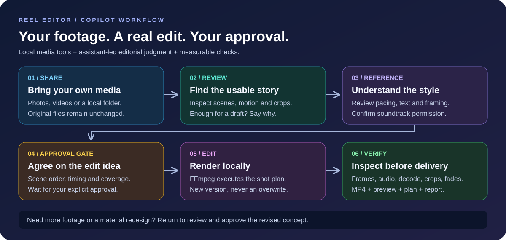
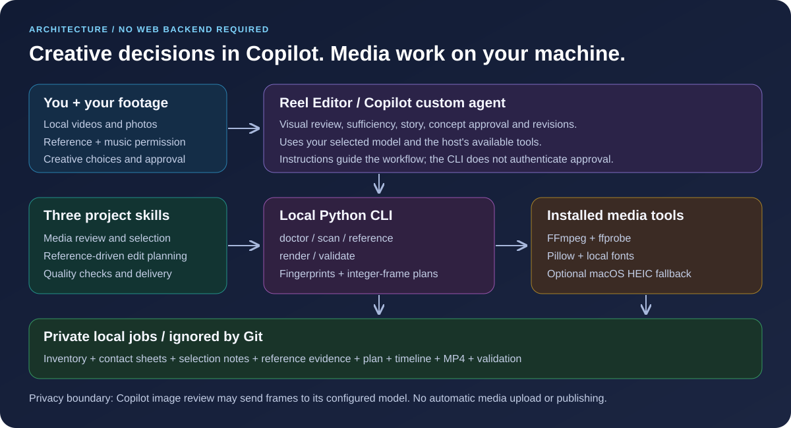

<div align="center">

# Reel Editor for Copilot

**Your footage. A thoughtful edit. Your approval.**

A VS Code Copilot custom agent for turning local videos and photos into
reference-inspired reels, with visual review, explicit creative approval,
FFmpeg rendering and verifiable output.

[Get started](#quick-start) | [Workflow](#the-editing-workflow) |
[Local tools](#local-commands) | [Privacy](#privacy-and-responsible-use)

</div>



> **This is a Copilot agent, not a web application.** Open this repository in
> VS Code and select **Reel Editor**. There is no backend, database, cloud
> deployment or one-click AI video generator to run.

## What it does

- **Reviews your material first.** Inventories nested media folders, creates
  timestamped contact sheets, identifies usable ranges and reports whether the
  available footage can support the requested edit.
- **Uses a reference thoughtfully.** Analyzes composition, captions, scene-change
  candidates and an audio envelope, then explains what your footage can match.
- **Builds an edit with you.** Proposes framing, captions, scene order, duration,
  music and optional subject coverage before asking for approval.
- **Works with photos, videos or both.** Supports exact shot lengths, gentle
  photo motion, crop control, eligible slow motion and caption opacity fades.
- **Checks the export.** Verifies frame count, timestamps, full decoding,
  requested coverage constraints and authorized soundtrack alignment.
- **Keeps revisions traceable.** Saves plans, source fingerprints, previews and
  reports in new versioned output directories without overwriting originals.

The assistant makes editorial decisions. The Python CLI handles repeatable
media operations; it does not automatically understand scenes, recognize
people or decide which footage tells the best story.

## Contents

- [Quick start](#quick-start)
- [The editing workflow](#the-editing-workflow)
- [Architecture](#architecture)
- [Capabilities and limits](#capabilities-and-limits)
- [Local commands](#local-commands)
- [Plans and outputs](#plans-and-outputs)
- [Repository structure](#repository-structure)
- [Testing and verification](#testing-and-verification)
- [Troubleshooting](#troubleshooting)
- [Privacy and responsible use](#privacy-and-responsible-use)
- [Contributing and license](#contributing-and-license)

## Quick start

### 1. Get the project

```sh
git clone https://github.com/amanraj-ms/reel-editor-agent.git
cd reel-editor-agent
```

Open **this folder itself** in VS Code, not its parent. You need Copilot access
with custom-agent, skill and tool support. Use your selected model; the project
does not require a fixed model, extra paid plugin or Azure account.

### 2. Check local prerequisites

| Requirement | Purpose |
|---|---|
| Python 3.9+ | Runs the local media CLI |
| FFmpeg and ffprobe on `PATH` | Media inspection, encoding and validation |
| Pillow 10+ | Image handling, contact sheets and caption rasterization |
| A local TrueType/OpenType font | Caption rendering |
| Optional macOS `sips` | HEIC decoding fallback |

```sh
python3 scripts/media_tools.py doctor
```

If Pillow is missing, create an isolated environment and install the dependency:

```sh
python3 -m venv .venv
# macOS / Linux
source .venv/bin/activate
# Windows PowerShell: .venv\Scripts\Activate.ps1
python -m pip install -r requirements.txt
python scripts/media_tools.py doctor
```

Install FFmpeg separately if `doctor` reports it missing. The project does not
install system packages automatically. On Windows, use an available Python
command such as `py -3` when `python3` is not present.

### 3. Start a fresh Copilot chat

Select **Reel Editor** from the agent picker and say:

> Hi! I have a local folder of travel videos and photos I'd like to edit.

The agent asks for your media first. It assesses whether there is enough usable
material before requesting a sample reel.

You can also provide known choices together:

> Make a 20-second upright travel reel from `/path/to/trip`. Use
> `/path/to/sample.mp4` as a style reference. Prefer real video movement over
> long photo holds, and keep everyone visible in group shots. Use the caption
> "A little road, a lot of memories". I have permission to reuse the sample audio.
> Show me the edit concept before rendering.

Providing files or permission to reuse music **does not approve the edit
concept**. The agent must still present the idea and wait for your answer.

## The editing workflow

| Stage | What happens | Decision or output |
|---|---|---|
| **1. Intake** | Share your own media or a local folder | Recorded input paths |
| **2. Review** | Inspect contact sheets, quality, ranges and scene variety | Enough for a draft, or specific missing footage |
| **3. Reference** | Review the sample, captions, pacing and soundtrack | Feasible style and confirmed music permission |
| **4. Approve** | Agree on scene beats, framing, duration and coverage | Explicit approval of a versioned concept |
| **5. Edit** | Prepare reviewed sources and render the approved plan | Versioned local MP4 |
| **6. Verify** | Check technical output and visually inspect crops/fades | MP4, preview, notes, plan and validation report |

**If the footage is insufficient:** the agent asks for specific additions or
offers a shorter/simpler concept. A large file count is not evidence of enough
usable footage.

**For revisions:** a narrow request such as "replace this shot" authorizes only
that change. New media or a material redesign returns to review and approval.
Earlier exports remain intact.

**To resume:** ask the agent to continue from the saved job folder. Its
`brief.workflow` records the stage, media assessment, proposed concept and
approval. Already supplied originals and references should not be requested again.

These are agent-level workflow instructions, **not a tamper-proof authorization
system**. The standalone CLI neither runs the conversation nor authenticates
concept approval. It does check `audio.authorized` before using a soundtrack.

## Architecture



| Component | Responsibility |
|---|---|
| [Reel Editor agent](.github/agents/reel-editor.agent.md) | Guided conversation, editorial decisions and approval gates |
| [Media review skill](.github/skills/reel-media-review/SKILL.md) | Inventories, visual source review, sufficiency and selection |
| [Reference edit skill](.github/skills/reel-reference-edit/SKILL.md) | Reference analysis, permissions, frame-based plans and rendering |
| [Quality check skill](.github/skills/reel-quality-check/SKILL.md) | Technical validation, crop/fade inspection and revisions |
| [Local media CLI](scripts/media_tools.py) | `doctor`, `scan`, `reference`, `render` and `validate` |
| FFmpeg / ffprobe / Pillow | Decode, probe, encode, rasterize and measure media |
| Ignored local job folders | Persist private media derivatives, plans, notes and exports |

There is no app/backend integration, hosted service, automatic publishing or
shared cloud project state.

## Capabilities and limits

| Area | Supported | Important boundary |
|---|---|---|
| Inputs | MP4, MOV, M4V, MKV, AVI, WebM; JPEG, PNG, WebP, HEIC, HEIF, TIFF | Actual codec support depends on your local tools |
| Photos | EXIF orientation, per-shot crop centers, gentle 3.5% push-in | A basic crop is not a subject-aware composition engine |
| Video | Source ranges, fixed-fps output and eligible slow motion | No invented source detail or optical-flow interpolation |
| Framing | Upright or clockwise sideways composition inside portrait output | Sideways is an intentional composition choice, not a metadata correction |
| Captions | Multiple lines, local fonts, colors and opacity fades | No automatic transcription or speech-driven caption timing |
| Transitions | Hard cuts and opening/closing fades | No bundled arbitrary cross-dissolves or speed ramps |
| Music | One authorized soundtrack starting at source time zero | No downloading music, voice mixing, tempo changes or arbitrary audio offset |
| Coverage | Optional equal photo counts and equal total subject frames | Labels come from the user; no identity or gender inference |
| HDR | Catalogued with warnings | Direct HDR rendering is blocked; prepare and verify an SDR derivative separately |

The bundled renderer center-crops shots by default. Full-photo layouts, blurred
backgrounds, stabilization or other special treatments need deliberate local
preparation and verification; they are not automatic renderer features.

Real footage, useful scene variety and considered pacing matter more than the
number of transitions. A photo-led edit should be proposed as such, not
described as an all-video or cinematic result.

## Local commands

Run commands from the project root. Every output directory must be **new** and
outside the input being scanned. Keep private outputs under ignored `jobs/`.

```sh
# Inspect tool availability.
python3 scripts/media_tools.py doctor

# Inventory originals and generate contact sheets.
python3 scripts/media_tools.py scan \
  --input "/path/to/media" --output jobs/review-01

# Sample long or changing clips more densely.
python3 scripts/media_tools.py scan \
  --input "/path/to/clip.mp4" --output jobs/clip-review-01 --samples 16

# Inspect a reference after the source sufficiency checkpoint.
python3 scripts/media_tools.py reference \
  --input "/path/to/sample.mp4" --output jobs/reference-01

# Render a completed, reviewed plan after explicit concept approval.
python3 scripts/media_tools.py render \
  --plan jobs/edit-plan.json --output jobs/reel-v1

# Re-run technical checks for an existing export.
python3 scripts/media_tools.py validate --job jobs/reel-v1
```

`scan` defaults to six samples per video. A successful scan is **not** a full
decode or visual review. Failures are recorded explicitly and return nonzero.
Reference scene-change candidates and RMS peaks are evidence, not reliable
musical beat detection.

## Plans and outputs

Start with [the example plan](examples/plan.example.json), then replace its
placeholder paths, permissions and fingerprints using a current inventory.
It is a schema example, not a ready-to-render demo.

- Use absolute source/font/audio paths and current `size`/`mtime_ns` fingerprints.
- Specify each shot duration with integer `frames`; cumulative frames define cuts.
- Use `crop_center: [x, y]` in the range `0..1` for deliberate framing.
- `speed: 0.5` requests half-speed playback only if the actual source frame rate
  supports it without duplicated slow-motion frames.
- `orientation: "sideways"` rotates the landscape composition clockwise within
  the portrait canvas.
- Caption sizes and `y` positions refer to the logical canvas before rotation.
- `subject` is an editorial label supplied by the user, not an inferred identity.

For equal solo coverage, configure **both** `balance.equal_photo_counts` and
`balance.equal_subject_frames`. The latter includes video time; couple/group
coverage remains separate. Empty arrays disable these constraints.

| Output | Purpose |
|---|---|
| `inventory.json` and contact sheets | Original paths, fingerprints, metadata and source-review frames |
| `selection-notes.json` | Assistant-maintained editorial selections and limitations |
| `reference.json` | Reference metadata, candidate cuts and audio RMS envelope |
| `plan.json` and `timeline.json` | Saved brief, source manifest and exact frame grid |
| `reel.mp4` | Fixed-fps portrait H.264 video with optional AAC audio, fast-start enabled |
| `preview.jpg` and additional sheets | Each rendered shot's midpoint |
| `validation.json` | Output counts, timestamps, decoding, coverage and waveform checks |

The renderer rejects stale source fingerprints, invalid ranges, unsuitable slow
motion, noninteger frames, overflowing captions, unauthorized/missing/short
soundtracks and unprepared HDR video. Fingerprints detect size/mtime changes;
they are **not cryptographic authenticity checks**.

## Repository structure

```text
reel-editor-agent/
├── .github/
│   ├── agents/reel-editor.agent.md
│   └── skills/
│       ├── reel-media-review/SKILL.md
│       ├── reel-reference-edit/SKILL.md
│       └── reel-quality-check/SKILL.md
├── docs/assets/                 # Original, local SVG diagrams
├── examples/plan.example.json
├── scripts/media_tools.py
├── tests/test_media_tools.py
├── requirements.txt
└── jobs/                        # Local only; ignored by Git
```

Personal footage, rendered productions and private review plans are not part
of this repository.

## Testing and verification

```sh
python3 -m unittest discover -s tests -v
```

The suite includes source-change guards, approval-related audio checks,
coverage constraints, HDR/slow-motion rejection, EXIF orientation, caption
overflow, waveform-offset detection and a synthetic-media
scan/reference/render/validate integration test. The integration test checks
output imagery, caption timing, closing fade and unchanged originals.
FFmpeg integration tests are skipped when the tools are absent.

| Check | What it establishes | What it does not establish |
|---|---|---|
| Frame/timestamp validation | Exact planned duration and uniform output cadence | Good storytelling |
| Full decode | No reported decode errors | Smooth handheld source footage |
| Waveform correlation | Soundtrack alignment in several windows | Musical beat sync or listening quality |
| Counts and subject frames | Requested label-based coverage | Correct identities without user labels |
| Visual review | Checked sampled composition, captions and fades | Real-time playback if none was performed |

Agent discovery and instruction-following also need confirmation in a fresh
VS Code chat. Automated CLI tests do not prove every model will follow the
conversation correctly.

## Troubleshooting

| Symptom | Action |
|---|---|
| Agent is missing | Open this repository directly, use **Chat: Open Customizations**, check Agents/Skills and start a fresh chat |
| Skill did not activate | Explicitly request its name; the agent can read the exact local skill file if the host lacks skill loading |
| Missing Pillow / FFmpeg | Install only the reported dependency, then run `doctor` again |
| HEIC decode fails | On macOS check `sips`; elsewhere provide a supported Pillow decoder or orientation-corrected images |
| Source changed | Scan current originals into a new review folder and remap by path/fingerprint, not stale numeric IDs |
| HDR source is blocked | Prepare and visually verify a properly tone-mapped SDR derivative; do not relabel HDR as BT.709 |
| Output already exists | Choose a new versioned directory rather than replacing an earlier export |
| Music is shorter than the edit | Choose a suitable authorized track or explicitly agree on a shorter edit/audio preparation |
| Export feels like a slideshow | Reassess usable motion, shot variety and framing; approve a revised video-led concept rather than adding arbitrary effects |

See the official [custom-agent reference](https://code.visualstudio.com/docs/agents/reference/custom-agent-file-reference)
and [skills documentation](https://code.visualstudio.com/docs/agent-customization/agent-skills)
for host discovery and configuration details.

## Privacy and responsible use

- Media processing runs locally. **Copilot image viewing may send frames to its
  configured model** under your Copilot data settings; this is not an offline
  AI or confidentiality guarantee.
- Use media you are allowed to edit and obtain permission before reusing music,
  voices or identifiable private material. Inspecting a reference does not
  grant soundtrack rights.
- The tools do not download media, upload footage, publish reels, recognize
  faces or extract GPS/other EXIF fields into reports.
- Plans contain absolute local paths and may reveal filenames or editorial
  labels. Contact sheets and derivatives are private media too.
- `jobs/`, virtual environments, caches, dotenv files and common private-key
  formats are ignored. Inspect staged files before every public push; ignore
  patterns are safeguards, not secret detection.
- Do not commit credentials, private originals, personal review folders or
  production exports. Keep every original and earlier output unchanged.

## Contributing and license

Keep changes focused, update directly affected documentation and run the test
suite before proposing a pull request. Never include personal media in tests;
the existing integration test generates synthetic sources locally.

**No license has been selected yet.** Public visibility does not grant a
general license to reuse or redistribute this code. Choose and add an explicit
license before offering it for broader reuse or distribution.
